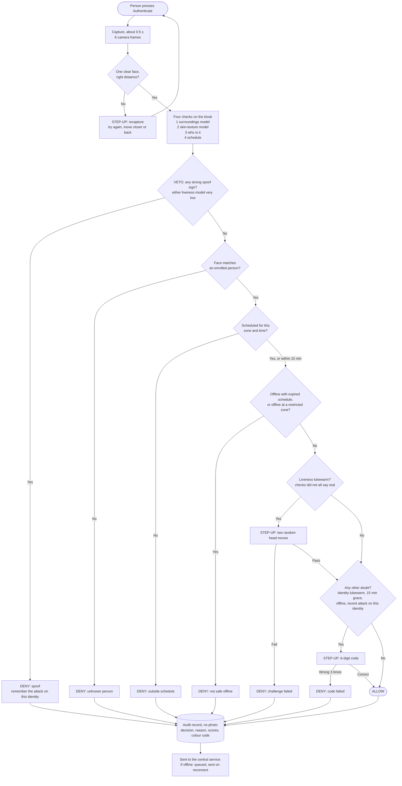
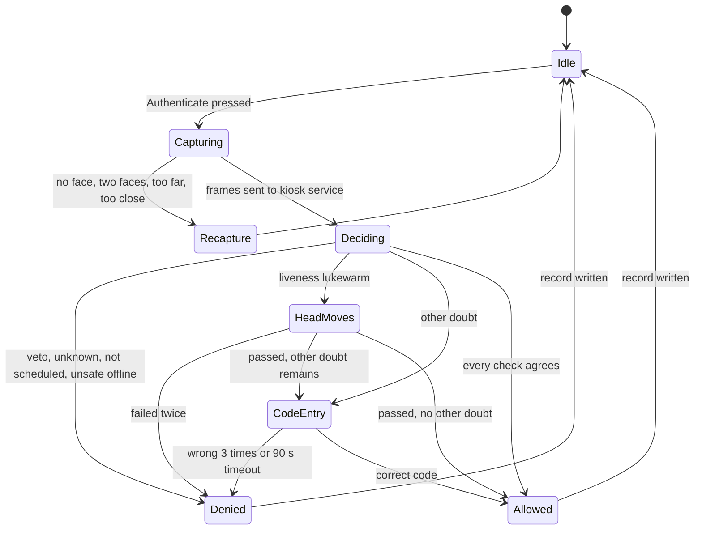

# Decision flow

This is the agreed target flow. Status of each part is in the table at the bottom:
some of it is built, some is on trial, some is still to do.

## The idea in one line

Any strong sign of a spoof is a veto. ALLOW needs every check to agree. When the
checks are unsure, the kiosk asks a random question a recording cannot answer:
two head moves in directions chosen at that moment.

## Flow chart

## States of one attempt

## The three outcomes

| Outcome | When | Time |
|---|---|---|
| ALLOW | All checks agree: live, known, scheduled, no doubt | within 2 s |
| DENY | Any veto, unknown person, not scheduled, unsafe offline, failed step-up | within 2 s (or after a failed step-up) |
| STEP-UP | The first answer is "not sure". Shown within 2 s, then the person does the extra step | 2 s to ask, a few more seconds to complete |

Three kinds of step-up, matching the brief ("recapture, simple action, or OTP"):
recapture, two random head moves, 6-digit code.

## How the checks vote

| Check | Strong spoof sign (veto) | Says "real" | In between |
|---|---|---|---|
| Surroundings model | below 0.12 | 0.80 or more | lukewarm |
| Skin-texture model | below 0.12 | 0.80 or more | lukewarm |

Numbers are starting values. They get set from labelled test attempts
(`scripts/rescore.py`), not by guessing.

## What is built and what is not

| Part | Status |
|---|---|
| Two liveness models, identity, schedule, offline queue and sync, code step-up | Built |
| Two random head moves | Built (14:25). Must start still; two correct random directions in a row; turning the wrong way is final. Not yet tried by a real person. A replay that guesses has about a 1 in 4 chance |
| Light response (random colour sequence) | On trial, OFF by default, colours softened. Measured and shown only. If adopted it belongs in step-up, not in every attempt |
| Veto rule (one strong spoof vote denies) | Built (14:25): any liveness model below 0.12 is DENY. The 0.12 is a first value from 5 attempts |
| Head moves first, then code if other doubt remains | To do. Today it is one or the other |
| Attack memory (step-up for an identity after a spoof attempt on it) | To do |
